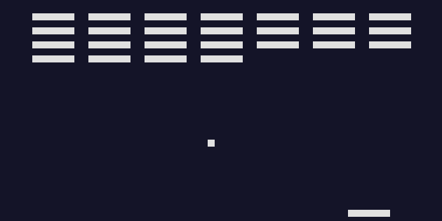

# CHIP-8 Emulator

[](https://github.com/Pornpipat-Ketkaew/chip8-emulator/actions/workflows/ci.yml)

A CHIP-8 emulator written from scratch in modern C++17, with SDL2 for graphics, keyboard input and sound.

CHIP-8 is a simple virtual computer from the 1970s. This project emulates its CPU, memory, display, keypad and timers, so it can run original CHIP-8 programs and games.

**▶ [Play it in your browser](https://pornpipat-ketkaew.github.io/chip8-emulator/)** (no download needed) · **[Download for Windows](https://github.com/Pornpipat-Ketkaew/chip8-emulator/releases/latest)**



## Features

- All **35 CHIP-8 instructions**, following the original COSMAC VIP behaviour
- 64×32 monochrome display with XOR sprite drawing and collision detection
- 16-key hexadecimal keypad mapped to the PC keyboard (works with any keyboard layout)
- 60 Hz delay and sound timers, with a 440 Hz beep
- Safe against broken programs: memory access is bounded, stack overflow/underflow is caught, and oversized ROMs are rejected
- **24 unit tests** (GoogleTest) for instructions, flags, timers, keys and edge cases
- Passes the community [CHIP-8 test suite](https://github.com/Timendus/chip8-test-suite) (CORAX+ opcode test and flags test)
- **Runs in the browser**: compiled to WebAssembly with Emscripten and published on GitHub Pages
- **Automated with GitHub Actions**: tests on Linux and Windows for every push, Windows release packages for every version tag, and automatic deployment of the web version

## How it works

The emulator core (`src/chip8.cpp`) is pure C++ with no graphics code, so it can be unit tested on its own. The SDL front end (`src/main.cpp`) only handles the window, keyboard and speaker. The same front end also builds for the web: on the desktop a normal loop calls `runFrame()`, while in the browser `emscripten_set_main_loop` calls it 60 times per second so the page never freezes.

Each frame (60 times per second), the main loop:

1. Reads keyboard events and updates the keypad.
2. Runs 10 CPU cycles. Each cycle **fetches** a 2-byte opcode from memory at the program counter, **decodes** it into its parts (X, Y, N, NN, NNN), and **executes** it.
3. Ticks the delay and sound timers.
4. Draws the 64×32 display to the window and turns the beep on or off.

```
chip8-emulator/
├── src/
│   ├── chip8.h / chip8.cpp   # emulator core: CPU, memory, display, timers, keypad
│   └── main.cpp              # SDL2 window, input, rendering and sound (desktop + web)
├── tests/
│   └── chip8_tests.cpp       # GoogleTest unit tests
├── web/
│   └── shell.html            # web page template for the WebAssembly version
├── .github/workflows/
│   ├── ci.yml                # build + test on Linux and Windows
│   ├── release.yml           # Windows zip on every version tag
│   └── pages.yml             # deploy the web version to GitHub Pages
└── CMakeLists.txt
```

## Download and play (Windows)

1. Download the latest `chip8-emulator-...-windows.zip` from the [Releases page](https://github.com/Pornpipat-Ketkaew/chip8-emulator/releases).
2. Unzip it anywhere.
3. Drag a `.ch8` game file (for example `roms/br8kout.ch8`) onto `chip8.exe`.

If Windows shows "Windows protected your PC", click **More info → Run anyway**. This appears because the program is not code-signed.

## Building

You need a C++17 compiler, CMake 3.24+, Ninja and SDL2. GoogleTest is downloaded automatically by CMake.

**Windows (MSYS2 UCRT64 terminal):**

```bash
pacman -S --needed mingw-w64-ucrt-x86_64-gcc mingw-w64-ucrt-x86_64-cmake mingw-w64-ucrt-x86_64-ninja mingw-w64-ucrt-x86_64-SDL2
```

**Ubuntu / Debian:**

```bash
sudo apt-get install build-essential cmake ninja-build libsdl2-dev
```

**Then build and run the tests:**

```bash
cmake -S . -B build -G Ninja -DCMAKE_BUILD_TYPE=Release
cmake --build build
ctest --test-dir build
```

## Usage

```bash
./build/chip8 path/to/program.ch8
```

ROM files are not included. Free test programs and public-domain games can be found in the [CHIP-8 test suite](https://github.com/Timendus/chip8-test-suite) and the [CHIP-8 Archive](https://github.com/JohnEarnest/chip8Archive).

## Controls

The CHIP-8 keypad is mapped to the left side of the keyboard:

```
CHIP-8 keypad      Keyboard
1 2 3 C            1 2 3 4
4 5 6 D            Q W E R
7 8 9 E            A S D F
A 0 B F            Z X C V
```

Press **Esc** to quit.

## What I learned

- How a CPU works internally: the fetch-decode-execute cycle, registers, the stack, and flags
- Bit manipulation in C++ (shifts, masks, XOR)
- Separating core logic from the user interface so it can be tested
- Writing unit tests, including edge cases, with GoogleTest
- Building cross-platform C++ with CMake, and setting up CI with GitHub Actions
- Shipping software: semantic versioning, release packages with their DLLs, and porting C++ to WebAssembly

## References

- [Guide to making a CHIP-8 emulator](https://tobiasvl.github.io/blog/write-a-chip-8-emulator/) by Tobias V. Langhoff
- [CHIP-8 test suite](https://github.com/Timendus/chip8-test-suite) by Timendus

## License

[MIT](LICENSE)
